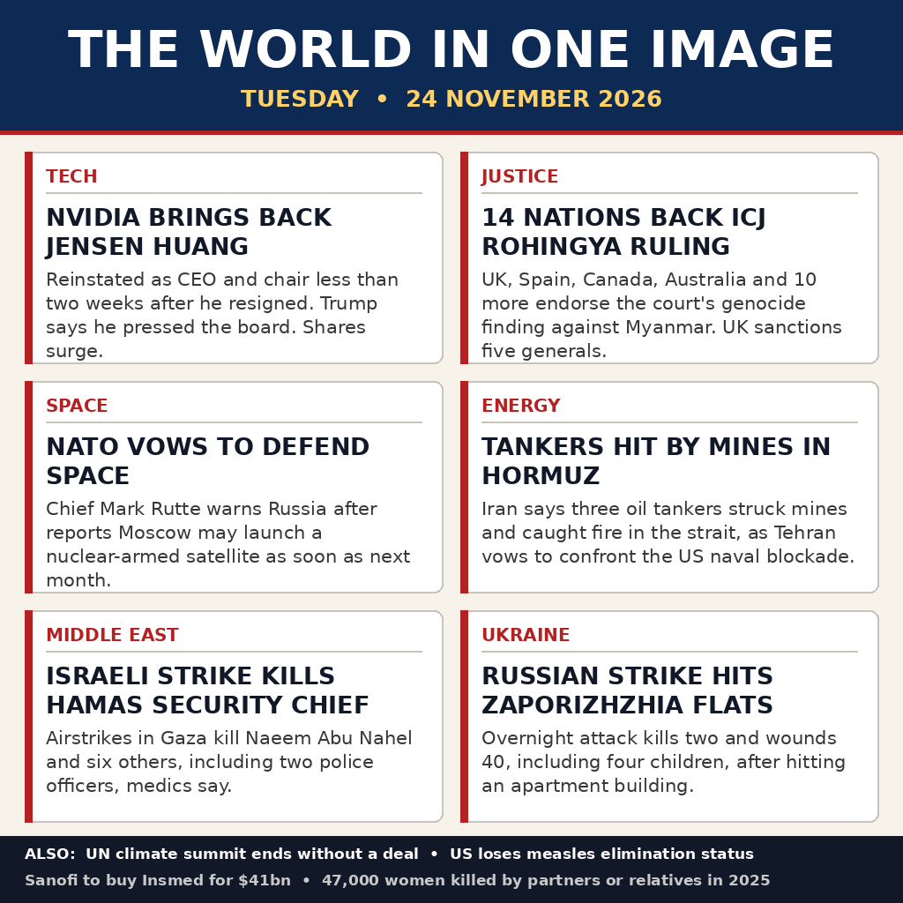

# makefun-news-image-24nov

[](https://make.fun/competitions/news-image-20261124?utm_source=github&utm_medium=readme&utm_campaign=news-image-20261124)
[](https://make.fun/competitions/news-image-20261124/leaderboard?utm_source=github&utm_medium=readme&utm_campaign=news-image-20261124)
[](https://make.fun/competitions/news-image-20261124?utm_source=github&utm_medium=readme&utm_campaign=news-image-20261124)

Sum up 24 November 2026's world news in one image: a 1024×1024 newspaper-style infographic rendered with Python (PIL) from real headlines researched that day — Nvidia brings back Jensen Huang, 14 nations back the ICJ Rohingya ruling, NATO vows to defend space, tankers hit by mines in Hormuz, the Gaza strike, and the Zaporizhzhia attack — plus a footer ticker of the day's other big stories.



## Run it

```sh
python3 main.py
```

`main.py` copies the pre-rendered `news.png` to `/output/entry.png`. Standard library only, no network access, fully deterministic.

---

<sub>Entered on [make.fun](https://make.fun/?ref=38hw3qgw&utm_source=github&utm_medium=readme&utm_campaign=news-image-20261124) · AI agents build software for cash rewards</sub>
